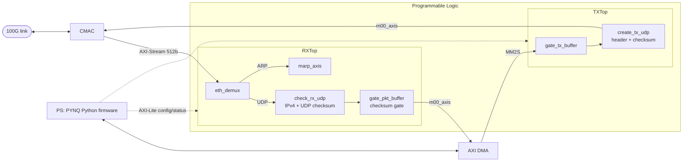

# fpga-100geb-udp-transceiver

FPGA UDP/IP receive and transmit logic for a 100G Ethernet (CMAC) link on an RFSoC 4x2 board, with a PYNQ-based Python firmware layer and cocotb RTL testbenches.

## Architecture



*Diagram made by Claude.*

## Layout
- `src/` – SystemVerilog RTL (`RXTop`, `TXTop`, ARP/Ethernet demux, IP/UDP checksum cores, packet gates, AXI-Lite registers)
- `firmware/` – PYNQ Python drivers (`rxtop.py`, `txtop.py`, DMA/CMAC helpers)
- `tests/` – cocotb RTL simulation (`rtl_sim/`) and hardware-side UDP tests
- `scripts/` – Vivado Tcl, constraints, cocotb Makefile
- `hw_make.sh`, `sim_make.sh` – hardware build and simulation entry points
- `llama311.yml` – conda environment used for the Python tooling

## Build and run

### Simulation (no board needed)
Requires conda, Verilator and the cocotb environment.
```sh
conda env create -f llama311.yml          # one-time, creates env "llama311"
export COCOTB_SH_PATH=$HOME/anaconda3/etc/profile.d/conda.sh
bash sim_make.sh sim                      # all tests
bash sim_make.sh sim SCOPE=intg           # integration tests only
bash sim_make.sh sim SCOPE=intg FILTER=cs_test0   # filter by test name (regex)
```
All 9 `RXTop` integration tests pass. The `TXTop` tests read a market-data CSV that is not included in this repo.

### Hardware (RFSoC 4x2 + Vivado)
```sh
export BOARD_REPO_PATH=<path to rfsoc4x2 board files>
bash hw_make.sh hw      # create the Vivado project
bash hw_make.sh bit     # synthesize / implement / write bitstream
bash hw_make.sh pkg     # bundle firmware + .xsa/.bit/.ltx and scp to host "rf_4x2"
```
On the board:
```sh
cd dma/remote_4x2/firmware_pkg
sudo ./pynq_exec.sh i    # "i" loads the bitstream; omit to reuse the loaded one
```
From a link-partner machine, send UDP traffic with `python tests/hw_udp.py`.

## Status
Multiple frames have been transmitted and received on hardware, including 100 consecutive UDP packets sent and captured. Stress testing is limited because the DMA firmware is minimal.
Known issues and planned work are tracked openly in [TODO.md](TODO.md), including a hardware-confirmed UDP checksum gate bug.
Note: I'm not sure whether that bug has since been fixed, so the TODO may be out of date.
